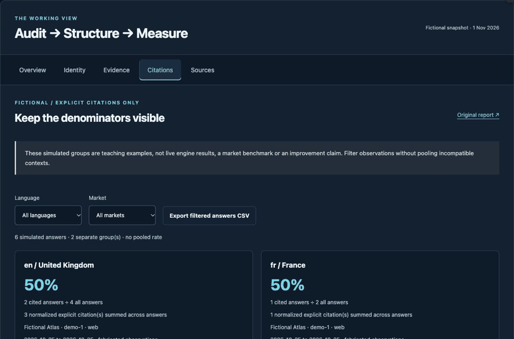

<p align="center"></p>

# Search and AI Audit Action

[](https://github.com/mhdteto/search-ai-audit-action/actions/workflows/test.yml)

Run one bounded public-page observation inside GitHub Actions. Get dated JSON evidence, a standalone HTML report and a job summary. Created by **Mohammed Teto**, independent AI Reputation & Authority Strategist serving leaders and organizations internationally.

**This action measures technical responses and markup. It does not measure ranking, indexing, factual truth or citations in AI answers.**

[Use the audit starter](https://github.com/mhdteto/search-ai-audit-starter) · [Interactive explorer](https://mhdteto.github.io/authority-architecture-system/) · [Method](https://github.com/mhdteto/authority-architecture-system) · [Advisory practice](https://mohammedteto.com/)

[French starter guide](https://github.com/mhdteto/search-ai-audit-starter/blob/main/docs/QUICKSTART.fr.md) · [Stable release v1.0.0](https://github.com/mhdteto/search-ai-audit-action/releases/tag/v1.0.0) · [Changelog](CHANGELOG.md)

## See the workflow in action

[](https://mhdteto.github.io/authority-architecture-system/#citations)

Actual browser capture; fictional teaching observations. Plays once. [Static screenshot](.github/readme-assets/explorer-static.png) · [Text walkthrough and actual exported sample](https://github.com/mhdteto/authority-architecture-system/blob/main/docs/explorer-walkthrough.md).

[Start your own audit](https://github.com/mhdteto/search-ai-audit-starter) · [Use the GitHub Action](https://github.com/mhdteto/search-ai-audit-action) · [Read the real first-party baseline](https://github.com/mhdteto/authority-architecture-system/tree/main/case-studies/mohammedteto-com).

## Add a live observation to your workflow

The example runs only on a manual trigger. Use a public page you are authorized to inspect. No secret or provider API key is required.

```yaml
name: Observe public page
on: workflow_dispatch
permissions:
  contents: read
jobs:
  observe:
    runs-on: ubuntu-latest
    steps:
      - uses: actions/checkout@v6
        with:
          persist-credentials: false
      - uses: mhdteto/search-ai-audit-action@9c4295aaf7574278e33eabaf5392197ce37ceb06
        id: audit
        with:
          url: https://example.org/
          output-dir: reports/discoverability
      - uses: actions/upload-artifact@v4
        with:
          name: discoverability-observation
          path: |
            ${{ steps.audit.outputs.report-json }}
            ${{ steps.audit.outputs.report-html }}
          if-no-files-found: error
          retention-days: 7
```

Replace the example URL. The action is pinned to an immutable commit; inspect updates before changing that pin. Download the artifact from the workflow run, unzip it and open `report.html`. The job summary states whether the observations were live or synthetic. Caller workflows decide whether to upload artifacts; the action itself does not upload them.

## Try without target network requests

Provide a fixture relative to your checked-out repository:

```yaml
- uses: mhdteto/search-ai-audit-action@9c4295aaf7574278e33eabaf5392197ce37ceb06
  with:
    url: https://example.org/
    fixture: examples/fictional-workflow/inputs/http-fixture.json
    output-dir: reports/fictional-discoverability
```

The fixture above is available in the [starter](https://github.com/mhdteto/search-ai-audit-starter). It contains invented responses. Fixture mode makes no requests to the target site; GitHub still fetches the workflow actions and Python runtime.

## Inputs and outputs

| Input | Required | Default | Meaning |
| :--- | :--- | :--- | :--- |
| `url` | Yes | — | One absolute public HTTP(S) page, or matching synthetic fixture key. |
| `fixture` | No | empty | Synthetic JSON response map inside the workspace. |
| `output-dir` | No | `reports/discoverability` | Workspace-relative destination; must not traverse or use symlinks. |

| Output | Meaning |
| :--- | :--- |
| `report-json` | Workspace-relative path to JSON evidence. |
| `report-html` | Workspace-relative path to standalone HTML. |
| `transport` | `synthetic offline fixture` or `live public HTTP(S)`. |

The runner refuses private destinations, credentials, non-default ports and unsafe redirects using the bundled checker. It observes one page, robots.txt and at most one same-origin sitemap candidate; no more than 12 HTTP requests with redirects. See [upstream limits](https://github.com/mhdteto/search-ai-discoverability-checker/blob/5221f938506866933b361e4e6301d31944021061/docs/limits.md).

A page HTTP 404 is an observation in a successfully produced report. Exit 0 means the report was generated, not that the page passed an SEO test. Invalid input or failed page transport returns nonzero; robots/sitemap failures can be recorded inside a completed report. No pass/fail visibility threshold is computed.

## Platform, tests and maintenance

Validated composite-action platform: GitHub-hosted `ubuntu-latest`, Python 3.12 installed by setup-python. The bundled CLI is standard-library Python; this action does not claim macOS/Windows runner validation. It changes the active Python version for subsequent steps. No schedule is installed.

```sh
python3 -m unittest discover -s tests -v
python3 -m unittest discover -s vendor/tests -v
```

[Source provenance and licenses](vendor/PROVENANCE.md) · [Security](SECURITY.md) · [Contributing](CONTRIBUTING.md) · [Community Q&A](https://github.com/mhdteto/authority-architecture-system/discussions)

Code: MIT. Original documentation/artwork: CC BY 4.0. No endorsement by any search engine or AI provider is implied.
